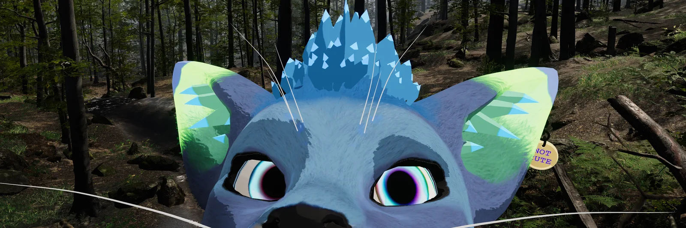
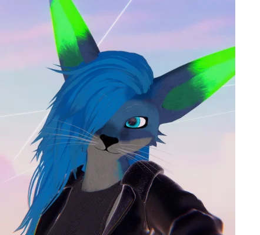
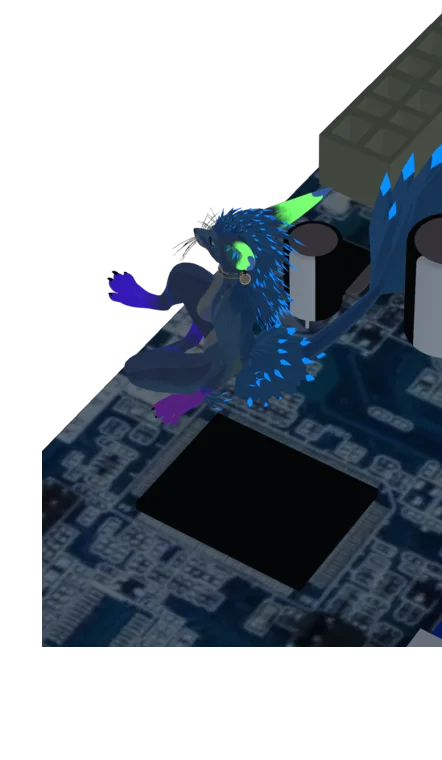
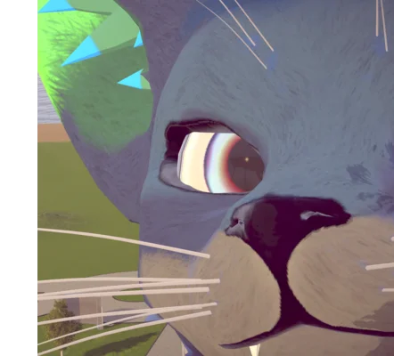

# heya, I'm Luna

I do stuff sometimes, if I feel like it

most of the stuff I make is just a result of me being annoyed about some other thing not working and deciding I know how it should be done better

I'm always up for a good side project, tho that risks there being a side side project, and side side side.. whatever. stuff's never done if you know what I mean

 

Work: **technical enablement specialist (end-user success, cross-functional troubleshooting and hands-on solution delivery)**\
Hobbies: **tinkering with hardware and software, music and photography**\
Favorite color: **rainbow**

## things i made

- [Telescope](https://github.com/LunarKittyy/Telescope) - stream your Android phone's camera to a virtual webcam on Linux or Windows. bit overengineered, but that's the point, so you can do anything
- [machinechess](https://github.com/LunarKittyy/machinechess) - let LLMs fight in a match of chess, or play with one. just a warning that either option might lead to psychological damage from looking at what the AI does
- [kisscut](https://github.com/LunarKittyy/kisscut) - a sticker sheet maker with auto arrangement, outlines and other cool stuff
- [fetchquesttracker](https://github.com/LunarKittyy/fetchquesttracker) - a quest/item tracker web app with Firebase cloud sync I made for tracking how many olives I still have to feed to the chicken
- [aseprite-compiler](https://github.com/LunarKittyy/aseprite-compiler) - a script that automates Aseprite compilation and install. hopefully still not broken

I also maintain a fork of gendermodspigot, which adds Spigot support for Wilfire's female gender mod: [gendermodspigot-neo](https://github.com/LunarKittyy/gendermodspigot-neo)

 

## experience

- Own the full lifecycle of self-initiated technical products, from ideation through delivery to long-term maintenance
- Partner directly with end users to identify friction points and deliver measurable improvements to their daily workflows
- Leverage a fast-learning mindset to ramp up on emerging technologies and add value from day one
- Manage a diverse portfolio of initiatives at various stages of completion

 

<!-- discord goes here -->

also most important, cats are the best

🏳️‍⚧️ meow :3
